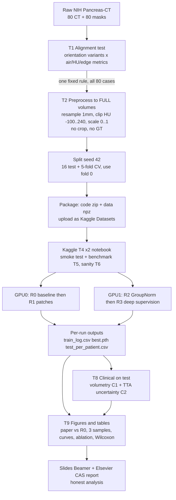
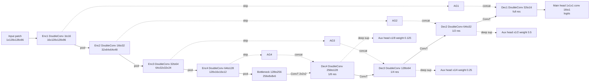
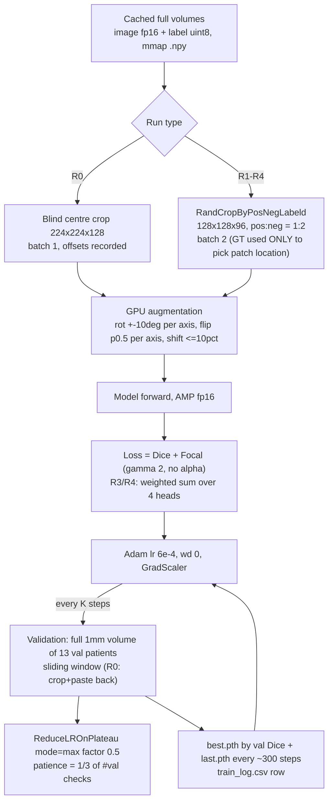
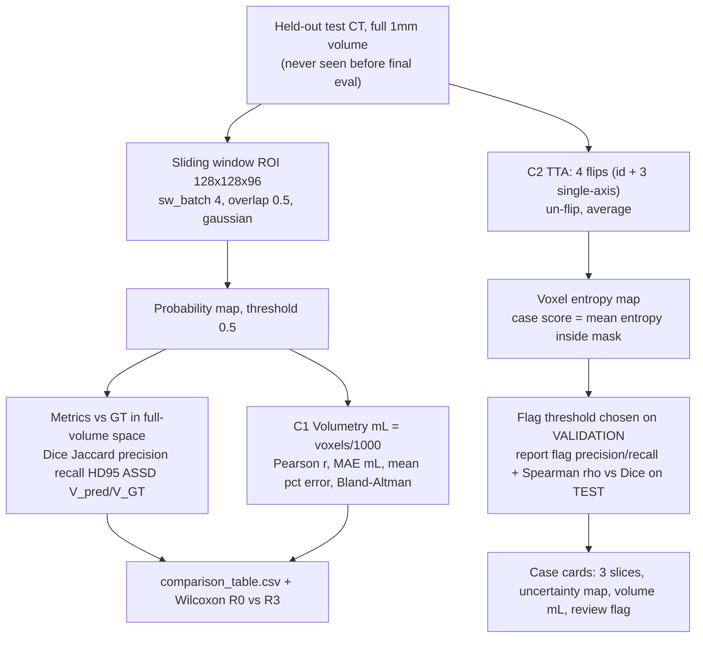
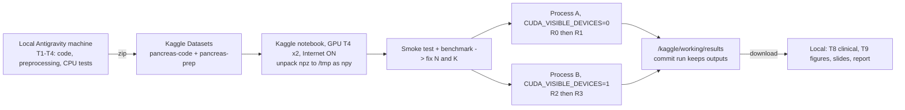

# MASTER_BUILD_GUIDE.md — 3D Pancreas Segmentation (22AIE437 Medical Image Processing)

**Replication of** *Tsewalo Tondji et al., "Deep Learning Model with Attention Mechanism for a 3D Pancreas Segmentation in CT Scans", Mathematics 2025, 13(24), 3942, doi 10.3390/math13243942* **+ 3 modifications (M1–M3) + 2 clinical extensions (C1–C2).**
**Team:** Baranidharan (CB.SC.U4AIE23015) · Pranav (…054) · Antonio Roger (…104) · Naren B S (…152)
**Deadline reality:** everything must be built and trained **tonight**. This file is the single source of truth. It supersedes `PROJECT_SPEC.md` and `ANTIGRAVITY_PROMPT.md` wherever they differ (see §1).

> Legend: **[PAPER]** = verified in the paper's full text · **[REPO]** = verified by reading the repo · **[EST]** = my estimate, *measure it* · **[DECISION]** = a choice made for you, change if you disagree.

---

## 0. HOW TO USE THIS FILE (do this first)

1. Create a working folder with: this file, `22AIE437_Final_Project_Guidelines.pdf`, `MIP.pdf` (Review-1 slides), the base-paper PDF (https://www.mdpi.com/2227-7390/13/24/3942/pdf), the repo `Pancreas-Seg-MIP-main/`, and the dataset path.
2. Open the folder in Antigravity and paste the **kickoff prompt** below.
3. Let Claude work task by task (§9). Every task has an acceptance test. Commit after each.

### Kickoff prompt (paste verbatim)

```
You are a senior medical-imaging ML engineer. Read MASTER_BUILD_GUIDE.md completely, then skim
the repo (src/config.py, models/{model,attention}.py, losses.py, train.py, evaluate.py, metrics.py,
data/{prepare_data,preprocessing,dataset}.py, test_all.py, docs/REPORT.md).
Reply with a plan of <= 20 lines (task order, files you will touch, risks), then start Task T1
immediately. Follow the HARD RULES in section 15. Report after each task in the format in
section 15. Ask me only if truly blocked (missing data path, no GPU). Everything is due tonight:
be efficient, never cut corners on correctness, never fabricate a number.
```

---

## 1. DECISIONS AND CORRECTIONS vs the earlier spec (read carefully)

| # | Topic | What the paper / repo actually shows | **[DECISION]** |
|---|---|---|---|
| D1 | **Focal loss α** | **[PAPER]** Eq. 2 is a γ-modulated cross-entropy with **no α term**; γ unspecified. **[REPO]** uses α = 0.25 (positives weighted 0.25, i.e. *down*-weighted). | R0 = paper-exact: **γ = 2, α = None (α_t = 1)**. Keep a `--focal_alpha` flag; document α = 0.25 as the old Review-1 setting. All of R0–R4 share this loss. |
| D2 | **Attention gate fidelity** | **[PAPER]** §3.2.3: project x and g to C channels + LayerNorm → add → ReLU → reduction layer (C/2) + LayerNorm → sigmoid 1×1×1 conv → x⊙ψ → final 1×1×1 conv + norm. **[REPO]** projects straight to C/2, no reduction layer / 2nd LayerNorm / final conv. | Ablation uses the repo gate (`--ag simple`, already tested). Implement `--ag paper` as a flag; run it as an *optional* extra only if time remains. **Document this deviation in the slides/report.** |
| D3 | **LR scheduler metric** | **[PAPER]** ReduceLROnPlateau on **validation loss**, patience 100. **[REPO]** monitors validation Dice. | Keep val-Dice (`mode=max`); document as deviation. Flag `--sched_metric {dice,loss}`. |
| D4 | **Paper's ± is not per-patient** | **[PAPER]** 80.8 ± 2.1, range 78.6–84.1 is far too tight for per-patient Dice on 16 cases; most likely across the 5 folds (paper does not say). | Paper-vs-ours table gets a footnote: "paper SD likely across folds; ours across 16 test patients". Never present them as like-for-like. |
| D5 | **Case count** | **[PAPER]** abstract/intro say 82; §3.1.1 says 81 minus 2 without masks (= 79); split arithmetic 5×13+16 = 81. | We use TCIA v2 = **80**. Cite all three numbers once. |
| D6 | **In-plane spacing** | **[PAPER]** says pixel sizes ≈ 0.5 mm. Our data: ≈ 0.86 mm (e.g. case 0001). | Cite TCIA/own data for spacing, not the paper. |
| D7 | **Augmentation implementation** | **[REPO]** CPU `scipy.ndimage.rotate` on 224×224×128 — slow. | One **GPU** augmentation function (affine_grid/grid_sample) used identically by *all* runs (§7.4). |
| D8 | **Validation protocol** | **[REPO]** validates on the crop. | **All runs validate/test on the full 1 mm volume** (R0: predict its crop, paste back, rest = background). |
| D9 | **Hardware claim** | Review-1 slide 8 blames T4/batch 1 and says authors likely had bigger GPUs. **[PAPER]** authors used a **T4 16 GB**. | Delete that claim. State true hardware per run. |
| D10 | **TTA budget** | 8-flip TTA on 29 volumes is too slow for tonight **[EST ~1.5 h]**. | Default **4 flips** (id, 3 single-axis) at overlap 0.25 for C2; 8-flip only if the benchmark says it fits. |

---

## 2. SITUATION SNAPSHOT

**Review-1 (Sept 2):** replicated the 3D Attention U-Net in PyTorch; best test Dice **0.316** vs paper **0.808**. Over-segmentation: precision ≈ 0.22, recall 0.5–0.85, median pred/GT volume 2.4×, every test point above the identity line.

| Run | Crop | Loss | Epochs | Test Dice | ASSD | HD95 |
|---|---|---|---|---|---|---|
| 1 | blind centre | Dice+Focal | 100 | 0.192 | 13.67 | 42.46 |
| 2 | **GT-centroid (invalid)** | Dice+Focal | 300 | 0.283 | 9.17 | 34.55 |
| 3 | **GT-centroid (invalid)** | Dice only | 300 | 0.316 | 8.62 | 32.36 |

**Evidence gathered by reading figures/code (not by running code):**
1. `results/1_segmentation_overlays.png`: 2 of 3 "pancreas" overlays sit on **heart / lung-dome slices**. The model's predictions land in the same wrong place → likely **label–image misalignment**, and runs 2–3 used a **GT-centroid crop** that leaks position (the label is always at the crop centre). So 0.3 Dice may partly be a position prior. *(Hypothesis; T1 tests it.)*
2. `results/2_training_curves.png`: val Dice **peaks ≈ 0.3 at epochs 40–80, then falls to ≈ 0.13** while train loss keeps falling → degradation/overfitting, **not** a "plateau" as `docs/vis_results.md` claims.
3. Docs contradict each other (blind vs GT crop; "paper ≈ 0.86" is wrong → **0.808**; "Not alignment" in `REPORT.md`; T4 vs RTX 6000 Ada; README "2.3 GB" vs ~19 GB observed).
4. Small code issues **[REPO]**: training log writes one LR value for every row; validation/eval on the crop only; checkpoint choice by 13 noisy validation volumes.
5. **Not available to me:** the dataset, `splits/patient_splits.json`, the Review-1 `.tex` source. Splits must be regenerated (seed 42) — verify they match the old fold-0 IDs if the file is found.

**Goal tonight:** (1) find/fix the alignment problem, (2) run a clean, leakage-free baseline R0 and three cumulative modifications R1–R3 on identical settings, (3) add volumetry + reliability flag, (4) produce all rubric figures/tables from saved outputs, (5) teammates write Beamer + Elsevier report in parallel. **A negative result is acceptable; a fabricated number is not.**

---

## 3. RUBRIC → DELIVERABLES (from `22AIE437_Final_Project_Guidelines.pdf`)

| Rubric item | Deliverable |
|---|---|
| Beamer (LaTeX) 12–15 slides; `.tex` + `.bib` + PDF; no PPT | `slides/` — extend Review-1 deck (**need the `.tex` source from teammates**) |
| Code reproducing results (GitHub/zip) | this repo + `scripts/run_ablation.sh` + `REPRODUCE.md` |
| Elsevier CAS single-column LaTeX report (before end-sem) | `report/` |
| Group names + roll numbers on title slide + report title page | header above |
| Dataset slide (name, #images, labels, split, task, objectives, metrics) | slide 2 |
| Base paper: title/authors/venue/year + architecture diagram + key blocks | slides 3–5 |
| **Paper vs replicated table: Dice + Jaccard (IoU)** (+ HD95, ASSD) | slide 6 (Jaccard in paper = "n/r") |
| **3 samples: Input / Ground Truth / Predicted mask** | slide 7 (best / median / worst) |
| Code structure, logs/curves (loss + metric), training settings (framework, optimizer, LR, batch, epochs, hardware) | slides 8–9 |
| Modification + modified architecture diagram | slides 10–11 |
| Baseline vs modified table, same metrics/split/settings | slide 12 |
| Ablation (if improved) **or** honest failure analysis + next steps | slides 13–14 |
| Conclusion, future work, **member contributions**, references | slide 15 |
| Every member presents and can answer on any part | §14 viva sheet |

---

## 4. BASE PAPER — REPLICATION FIDELITY TABLE

**[PAPER] numbers (NIH, Table 1):** Dice **80.8 ± 2.1 %** [78.6, 84.1] · HD95 **8.1 ± 1.6 mm** · ASSD **2.1 ± 0.3 mm** · 2.75 s/volume · 3D U-Net without attention **77.6 ± 1.6 %**.
**MSD (Table 2):** 78.1 ± 1.1 % · HD95 12.3 ± 1.5 · ASSD 3.3 ± 0.3.
**Loss ablation (Table 3, NIH):** Dice 74.8 ± 2.0 · Dice+CE 77.4 ± 2.8 · **Dice+Focal 80.8 ± 2.1**. Friedman p = 0.0408 (NIH); only Dice+Focal vs Dice-only significant (p = 0.03).
**Setup [PAPER]:** TensorFlow 2.16.1, **NVIDIA T4 16 GB**, 8 cores, 48 GB RAM · Adam, LR "6×10⁴" (typo → 6×10⁻⁴) · ReduceLROnPlateau patience 100 epochs · 5 folds × 13 + 16 test · aug: rotation ±10° per axis, flip p 0.5, shift ≤ 10 % · HU [−100, 240] → [0,1] → 1 mm → fixed crop 224×224×128 "centred approximately on the abdominal region … without relying on ground truth".
**Unspecified in the paper:** batch size, epochs, γ, scheduler factor/min-LR, weight decay, crop-centering algorithm.

| Item | Paper | Repo today | R0 tonight |
|---|---|---|---|
| Channels | text "2→16" (typo); Fig. 1: 16→256 | 16-32-64-128-256 (5,668,269 params ✔ verified by arithmetic) | same |
| Norm | BatchNorm | BatchNorm | BatchNorm |
| Attention gate | §3.2.3 (see D2) | simplified | simplified (+ optional `--ag paper`) |
| Loss | Dice + γ-focal, **no α** | Dice + focal α 0.25 | **Dice + focal γ 2, no α** (D1) |
| Dice formula | Eq. 3 lacks the factor 2 | standard 2·\|A∩B\|/(\|A\|+\|B\|) | standard |
| Scheduler | on val loss | on val Dice | val Dice (D3) |
| Crop | fixed 224×224×128, no GT | GT-centroid in runs 2–3 (**invalid**) | **blind geometric centre**, no GT |
| Batch | unspecified | 1 | 1 |

---

## 5. DATASET

| Property | Value |
|---|---|
| Name | **NIH Pancreas-CT** (TCIA; healthy pancreas, contrast-enhanced portal-venous CT) |
| Cases | **80** image/label pairs (TCIA v2; #25, #70 removed by TCIA) |
| Task | Binary voxel segmentation: pancreas = 1, background = 0 |
| Raw | 512×512×(181–466) slices; slice thickness 1.5–2.5 mm; in-plane ≈ 0.86 mm in our case 0001 (512×512×240, 0.86×0.86×1.0) |
| Labels | Manual (medical student, radiologist-verified) NIfTI masks; pancreas ≈ 0.5 % of abdomen volume **[PAPER]** |
| Splits | seed 42; **16 test** (never used for training/selection) + 64 → 5 folds (≈ 13 val each). **Tonight: fold 0 only** (51 train / 13 val) + 16 test |
| Provenance | (a) course `Processed_data/{images,labels}` NIfTI; (b) IDC S3 DICOM → NIfTI with z-spacing recomputed from `ImagePositionPatient` (IDC metadata had 0.01–0.83 mm) + TCIA labels. **T1 decides which source is used.** |
| Limit | Healthy pancreas only → volumetry validates *measurement accuracy*; **no disease claim** |
| Cite | TCIA Pancreas-CT collection (Roth et al.) directly; verify DOI. (Paper's own ref [18] cites TCGA-GBM by mistake.) |

---

## 6. DIAGRAMS

### 6.1 End-to-end workflow



### 6.2 Architecture — final model R3 = **3D Attention U-Net-GN-DS**



* **DoubleConv** = `Conv3d(3×3×3, pad 1, bias=False) → Norm → ReLU` × 2. Norm = **BatchNorm3d** (R0, R1) or **GroupNorm(8, C)** (R2, R3, R4; all C ∈ {16,32,64,128,256} divisible by 8).
* **Attention gate (additive):** θ = LN(Conv1×1×1(x)), φ = LN(Conv1×1×1(g)), f = ReLU(θ+φ), α = σ(Conv1×1×1(f)), x̂ = x ⊙ α, F_int = C/2; g = decoder feature, trilinear-upsampled to the skip size. **LayerNorm over (C,H,W,D) makes statistics depend on the input size → keep the ROI identical in training and inference for R1–R4.**
* **Outputs:** train mode → `[main, aux2, aux3, aux4]` logits, all trilinear-upsampled to full patch size; eval mode → `main` only. Probability = sigmoid; mask = p > 0.5.
* **R0 baseline** = same net, BatchNorm, no aux heads, input 1×224×224×128 (bottleneck 14×14×8). **R4** = R3 with each AG replaced by identity skip (plain 3D U-Net).
* **Parameters:** ≈ 5.67 M (GN and BN both carry 2C affine params; aux heads add a few dozen).

### 6.3 Training pipeline (one run)



### 6.4 Inference + clinical pipeline



### 6.5 Kaggle execution flow (T4 × 2)



---

## 7. COMPONENT SPECIFICATIONS

### 7.1 T1 alignment test (GATE — do first, time-box 60–90 min)
`tools/check_alignment.py`. For ≥ 5 patients, then all 80, load raw image (HU) and label **in the same voxel grid**, and for each candidate transform of the *label array* — all 8 flip combinations of (x, y, z), each with and without x↔y transpose (16 variants) — compute:
* `air_frac` = fraction of label voxels with HU < −200 (must be ≈ 0),
* `mean_HU` inside the label (contrast-enhanced pancreas ≈ 60–130 HU),
* `in_range_frac` = fraction in [60, 180] HU (high),
* `edge_score` = mean image-gradient magnitude on the label surface divided by the same quantity for a 10 mm-shifted label (> 1 = label follows real edges).
Choose the variant with min air / max in-range / max edge score; apply **one fixed rule to all 80**; write `results/alignment/alignment_report.csv` (80 rows, before/after) and coronal + sagittal overlays. Also compare the two data sources (course NIfTI vs IDC-converted) and keep the one that passes.
**Accept:** after the fix, air_frac ≈ 0 and in_range high for all 80; overlays show pancreas at the correct anatomical level (upper abdomen: near kidneys/splenic vein, not heart/lung). **If no variant passes**, stop and tell me — do not proceed silently.

### 7.2 T2 preprocessing (no cropping, no GT use)
SimpleITK resample to 1×1×1 mm (linear for CT, nearest for label, default HU −1024 padding) → apply the T1 orientation rule → clip [−100, 240] → scale [0,1] → store **full volume** `image` float16 + `label` uint8 in `.npz` (compressed, **[EST] 2–4 GB total**) + `meta.json` (original shape/spacing/origin/direction, fix applied) + manifest CSV + QC (shape, spacing, range, label voxels). Provide `blind_center_crop(shape, (224,224,128)) → offsets` (pad symmetrically if smaller) and `paste_back(crop_pred, offsets, full_shape)`.
**Accept:** 80/80 QC pass; crop→paste-back round-trips the voxels inside the crop.

### 7.3 Loss, metrics, statistics
* **Dice loss:** `1 − (2Σpg + ε)/(Σp + Σg + ε)`, ε = 1e-5, per sample, p = sigmoid(logit).
* **Focal (paper Eq. 2):** `−[g(1−p)^γ log p + (1−g)p^γ log(1−p)]` mean over voxels, γ = 2, **no α** (D1; `--focal_alpha` optional). **Total = Dice + Focal.**
* **Deep supervision:** `L = Σ_i w_i·(Dice+Focal)(head_i)`, w = [1, ½, ¼, ⅛]/1.875.
* **Metrics (spacing-aware, full-volume 1 mm):** Dice, **Jaccard = |A∩B|/|A∪B|** (J = D/(2−D)), precision, recall, **HD95**, **ASSD**, volume (mL), V_pred/V_GT. Empty prediction → report `inf` and count it separately (never drop silently).
* **Statistics:** mean ± SD over 16 test patients; paired **Wilcoxon** (R0 vs R3, and consecutive runs) with an n = 16, single-fold, single-seed caveat; Spearman ρ (uncertainty vs Dice); Bland–Altman (volume).

### 7.4 Augmentation (GPU, identical for every run)
```python
import math, torch, torch.nn.functional as F
def gpu_augment(x, y, rot_deg=10., shift=0.1, flip_p=0.5):
    """x,y: (B,1,H,W,D) on GPU. One random affine per sample: rotation ±rot_deg about each axis,
    flip each axis with prob flip_p, translation ≤ shift of the size. Image bilinear, label nearest."""
    B, dev = x.shape[0], x.device
    a = (torch.rand(B, 3, device=dev) * 2 - 1) * rot_deg * math.pi / 180
    c, s = torch.cos(a), torch.sin(a); o, z = torch.ones_like(c[:, 0]), torch.zeros_like(c[:, 0])
    Rx = torch.stack([o,z,z, z,c[:,0],-s[:,0], z,s[:,0],c[:,0]], 1).view(B,3,3)
    Ry = torch.stack([c[:,1],z,s[:,1], z,o,z, -s[:,1],z,c[:,1]], 1).view(B,3,3)
    Rz = torch.stack([c[:,2],-s[:,2],z, s[:,2],c[:,2],z, z,z,o], 1).view(B,3,3)
    flip = torch.where(torch.rand(B, 3, device=dev) < flip_p, -1.0, 1.0)
    A = (Rz @ Ry @ Rx) * flip[:, None, :]                       # flip = negate columns
    t = (torch.rand(B, 3, 1, device=dev) * 2 - 1) * shift * 2   # normalised coords span 2
    grid = F.affine_grid(torch.cat([A, t], 2), x.shape, align_corners=False)
    xo = F.grid_sample(x, grid, mode="bilinear", padding_mode="border", align_corners=False)
    yo = F.grid_sample(y, grid, mode="nearest", padding_mode="zeros", align_corners=False)
    return xo, (yo > 0.5).float()
```
**Unit tests required:** identity parameters (rot 0, shift 0, flip_p 0) return the input; with flip forced, output equals `torch.flip`; label stays in {0,1}; image stays in [0,1]. (Rotation in normalised coordinates on non-cubic patches adds a negligible shear at ±10°; note it.)
*Note for the report:* flipping along S–I and A–P is paper-faithful but anatomically implausible; we follow the paper.

### 7.5 Model flags (defaults reproduce R0 exactly)
`--norm {batch,group}` · `--patch` (`--patch_size 128 128 96 --batch_size 2 --pos_neg 1 2`) · `--deepsup` · `--no_attention` · `--ag {simple,paper}` · `--focal_alpha` · `--sched_metric {dice,loss}` · `--steps N` · `--val_every K` · `--seed 42` · `--run_name`.
```python
def conv_block(i, o, norm="group"):
    N = (lambda c: nn.GroupNorm(8, c)) if norm == "group" else nn.BatchNorm3d
    return nn.Sequential(nn.Conv3d(i, o, 3, padding=1, bias=False), N(o), nn.ReLU(True),
                         nn.Conv3d(o, o, 3, padding=1, bias=False), N(o), nn.ReLU(True))

def ds_loss(outs, y, crit):                       # outs = [main, aux2, aux3, aux4], all full-size
    w = torch.tensor([1, .5, .25, .125], device=y.device); w /= w.sum()
    return sum(wi * crit(o, y) for wi, o in zip(w, outs))
```
Patches (MONAI): `RandCropByPosNegLabeld(keys=["image","label"], label_key="label", spatial_size=(128,128,96), pos=1, neg=2, num_samples=1)` → ≈ ⅓ of patches centred on foreground. **GT is used only to choose training-patch locations.**
Inference: `sliding_window_inference(vol, (128,128,96), 4, model, overlap=0.5, mode="gaussian")`, main head only, under `autocast`.

### 7.6 Trainer
Step-based (not epoch-based), AMP, Adam 6e-4 (wd 0), `ReduceLROnPlateau(mode="max", factor=0.5, min_lr=1e-7)` with patience = ⅓ of the number of validation checks, best checkpoint by validation Dice, `last.pth` (model + optimizer + scheduler + scaler + step + best) every ~300 steps with **automatic resume**, `train_log.csv` (step, train_loss, val_dice, **current lr**, seconds, peak VRAM), `torch.backends.cudnn.benchmark=True`, seeds fixed (42). Validation: full-volume, overlap 0.25 allowed for speed (same for every run); cap validation cost at ≈ 15 % of run time (use a 6-volume subset for intermediate checks and all 13 for the final best-checkpoint score if needed — apply identically to all runs, log it).
Data loading: unpack npz → uncompressed `.npy` in `/tmp` once; `np.load(mmap_mode="r")`; patches cropped from the memory map; 2 workers.

### 7.7 Clinical extensions (inference only)
```python
FLIPS = [(), (2,), (3,), (4,)]            # dims of (N,C,H,W,D); extend to 8 combos only if time allows
@torch.no_grad()
def tta_predict(model, vol, roi=(128,128,96), overlap=0.25):
    ps = []
    for f in FLIPS:
        x = torch.flip(vol, f) if f else vol
        with torch.autocast("cuda"):
            p = torch.sigmoid(sliding_window_inference(x, roi, 4, model, overlap=overlap, mode="gaussian"))
        ps.append(torch.flip(p, f) if f else p)                 # un-flip before averaging
    m = torch.stack(ps).mean(0)
    ent = -(m*torch.log(m+1e-8) + (1-m)*torch.log(1-m+1e-8))    # voxel uncertainty
    mask = m > 0.5
    return mask, ent, (ent[mask].mean().item() if mask.any() else float("nan"))

def volume_ml(mask, spacing=(1,1,1)): return mask.sum().item()*float(np.prod(spacing))/1000.0
def volume_agreement(vp, vg):
    vp, vg = np.array(vp), np.array(vg); d = vp - vg
    return dict(r=np.corrcoef(vp, vg)[0,1], mae_ml=np.abs(d).mean(), mape_pct=(np.abs(d)/vg).mean()*100,
                bias_ml=d.mean(), loa=(d.mean()-1.96*d.std(ddof=1), d.mean()+1.96*d.std(ddof=1)))
```
* **C1 volumetry:** every run, from the non-TTA main prediction → `volumes.csv`, scatter with identity line, Bland–Altman. State clearly: healthy pancreas, measurement accuracy only.
* **C2 reliability:** for R3: per-case mean entropy in the mask vs per-case Dice → Spearman ρ; flag threshold chosen **on validation** (e.g. 75th percentile of validation uncertainty), report flag precision/recall on test; also report whether TTA changes Dice vs single prediction. n = 16 → "suggestive, not proof".
* **Case cards** (best / median / worst): 3 axial slices Input | GT | Prediction, uncertainty map, volume mL, flag.

---

## 8. EXPERIMENT DESIGN (fair comparison)

| Run | Input | Norm | Patch + sliding window | Deep sup. | Attention | Loss |
|---|---|---|---|---|---|---|
| **R0** paper-faithful baseline | blind 224×224×128 crop, batch 1 | BN | – | – | yes | Dice+Focal (γ2, no α) |
| **R1** (+M1) | patches 128×128×96, batch 2 | BN | ✔ | – | yes | same |
| **R2** (+M2) | patches | **GN** | ✔ | – | yes | same |
| **R3** (+M3, final) | patches | GN | ✔ | ✔ | yes | same, per head |
| **R4** optional | as R3 | GN | ✔ | ✔ | **no** | same |
| *extras if GPU time remains* | R3 with `--ag paper`; R0 and R3 with a second seed | | | | | |

**Identical across runs:** fold-0 + 16 test, seed 42, Adam 6e-4, scheduler rule, GPU augmentation, AMP, threshold 0.5, **number of optimizer steps N**, full-volume evaluation. State plainly: one R0 step sees one 224×224×128 crop; one R1–R3 step sees two 128×128×96 patches. Old runs 1–3 are **historical**, not the baseline (runs 2–3 used the GT-centroid crop).
**Honest expectation:** N will be much smaller than Review-1's ≈ 15,300 steps **[EST]** because a T4 is several times slower than an RTX 6000 Ada. R0 may be under-trained relative to Review-1; say so in the report rather than hiding it.

Each result folder `results/R{0..4}_*/` contains: `train_log.csv`, `best.pth`, `last.pth`, `test_per_patient.csv`, `summary.json` (mean ± SD), curves PNG, `config.json` (all flags + git hash).

---

## 9. TASK LIST (in order; each has an acceptance test; commit after each: `git commit -m "T#: …"`)

| # | Task | Acceptance | Time-box tonight |
|---|---|---|---|
| T1 | Alignment test + fix (§7.1) | air ≈ 0, in-range high on all 80, overlays correct | 60–90 min |
| T2 | Full-volume preprocessing (§7.2) | 80/80 QC; crop round-trip test | 45 min (runs in background) |
| T3 | Metrics (+ Jaccard, precision, recall, volume, V ratio) and full-volume evaluation incl. R0 paste-back | unit tests on toy masks (known Dice/Jaccard/HD95); evaluation of a dummy checkpoint runs end-to-end | 45 min |
| T4 | Flags, GPU augmentation, step-based trainer, sliding-window validation, focal α=None (§7.3–7.6) | `python -m src.test_all` still 12/12 **plus** new tests: shapes (train/eval), GN divisibility, params ≈ 5.67 M, aux outputs full-size, R0 flags reproduce the old param count exactly, augmentation tests, one-step overfit on one patch lowers loss | 90 min |
| T5 | `tools/benchmark_steps.py` on Kaggle: 20 train iterations for R0 and R1/R2/R3 + one validation pass + one full-volume inference; report s/step and peak VRAM; **choose N and K** | N, K, val cost recorded in `CHANGELOG.md`. Target ≤ ~45–60 min per run on a T4; patch runs never < 3,000 steps *unless the benchmark proves impossible — then say so*. OOM fallback ladder: patch 112×112×80 → 96×96×64 → batch 1 (same for R1–R4) | 20 min |
| T6 | Sanity gate: R0-style 20–30 min run on corrected data | Report the val-Dice trend. If clearly above the old ≈ 0.3 → alignment bug mattered; if not, continue anyway and note it for the failure analysis. **Tell me before launching the full set** | 30 min |
| T7 | Launch R0–R3 (+R4) on T4×2 (§10) | 4–5 result folders, logs, checkpoints, per-patient CSVs | ~2–2.5 h wall-clock |
| T8 | TTA + volumetry + uncertainty (§7.7) | `volumes.csv`, `bland_altman.png`, `volume_scatter.png`, `uncertainty_vs_dice.png`, case cards; one command regenerates from checkpoints | 45 min |
| T9 | `tools/make_figures.py` | (a) paper vs R0 vs R3 table (paper Jaccard "n/r"; footnote D4), (b) 3 samples Input/GT/Pred, (c) loss + val-Dice curves, (d) ablation table/bars R0→R3(→R4), (e) per-patient Dice, volume scatter, over-segmentation scatter, (f) Wilcoxon; `captions.md` | 40 min |
| T10 | Docs: README (setup, one-command reproduction, Kaggle), fix wrong claims (0.808 not 0.86, GT-crop, hardware, "plateau"), `docs/FINAL_RESULTS.md` (per addition: improved / no effect / worse, with numbers) | all numbers come from saved CSV/JSON | 30 min |

**Parallel (teammates, starting now):** B = Beamer skeleton from Review-1 `.tex` (slides 1–5, 8–9 are mostly reusable); C = Elsevier CAS report skeleton + references (`.bib`); D = Kaggle operator (account, datasets, notebook); A = drives Antigravity.

---

## 10. KAGGLE T4 × 2 — STEP BY STEP

**Why this works:** each T4 has 16 GB; instead of multi-GPU training (DDP) we run **one independent process per GPU**, selected with `CUDA_VISIBLE_DEVICES`. GPU0 runs R0 → R1, GPU1 runs R2 → R3, so wall-clock ≈ 2 × (time per run). **Antigravity runs on your local machine and cannot use Kaggle's GPUs directly**: you develop and CPU-test locally, then run training in a Kaggle notebook.

**Before tonight (5 min, do it now):** log in to Kaggle, verify your phone number (needed for GPU and Internet), open your profile and check the weekly GPU quota **[EST ~30 h/week, ≤ 12 h per session — verify yours]**.

1. **Package the data (after T2).** Zip `prep/` (npz + meta + manifest + splits) → Kaggle → *Create → New Dataset* → name `pancreas-prep`. Upload is slow; start the moment T2 finishes.
2. **Package the code (after T4).** Zip the repo (without data/checkpoints) → new Dataset `pancreas-code`. (Alternative: a private GitHub repo + Internet ON.)
3. **Create the notebook.** *New Notebook* → right sidebar: **Add Input** (both datasets) → **Accelerator: GPU T4 ×2** → **Internet: On** (needed for `pip install monai SimpleITK nibabel`; check which are already preinstalled).
4. **Cell 1 — environment check**
```python
!nvidia-smi
import torch; print(torch.__version__, torch.cuda.device_count())   # must print 2
!pip -q install monai SimpleITK nibabel
!mkdir -p /kaggle/working/repo /tmp/prep && cp -r /kaggle/input/pancreas-code/* /kaggle/working/repo/
%cd /kaggle/working/repo
```
5. **Cell 2 — unpack data once** (npz → uncompressed npy in `/tmp`, **[EST] ~10 GB**, a few minutes): `python tools/unpack_npz.py --src /kaggle/input/pancreas-prep --dst /tmp/prep`.
6. **Cell 3 — tests + benchmark (T5):** `python -m src.test_all && python tools/benchmark_steps.py --data /tmp/prep`. Read s/step and VRAM; write N, K into `CHANGELOG.md`; adjust patch size if OOM.
7. **Cell 4 — sanity (T6, 20–30 min)** on one GPU. Look at the val-Dice trend; message me/Claude with the numbers before continuing.
8. **Cell 5 — launch the ablation (one process per GPU)**
```python
import subprocess, os
N, K = 4000, 250                                  # <- replace with the benchmarked values
F = {"R0_baseline":"",
     "R1_patch":"--patch",
     "R2_gn":"--patch --norm group",
     "R3_final":"--patch --norm group --deepsup"}
def chain(gpu, runs):
    cmds = [f"python -m src.train --run_name {r} {F[r]} --steps {N} --val_every {K} "
            f"--data /tmp/prep --out /kaggle/working/results/{r} >> /kaggle/working/logs/{r}.log 2>&1"
            for r in runs]
    return subprocess.Popen(["bash","-c"," ; ".join(cmds)], env=dict(os.environ, CUDA_VISIBLE_DEVICES=str(gpu)))
os.makedirs("/kaggle/working/logs", exist_ok=True)
p0, p1 = chain(0, ["R0_baseline","R1_patch"]), chain(1, ["R2_gn","R3_final"])
p0.wait(); p1.wait()
```
9. **Run unattended:** interactive sessions can idle-timeout. For the long run use **Save Version → "Save & Run All (Commit)"** so it keeps running with the browser closed and the outputs are saved. Run the smoke test/benchmark interactively first, then commit. `train.py` must **auto-resume** from `last.pth` (checkpoint every ~300 steps) so a dropped session can be re-launched.
10. **Monitor:** `!tail -n 5 /kaggle/working/logs/*.log` and `!nvidia-smi`. Both GPUs should show ≈ 100 % utilisation. Also watch CPU RAM (≈ 29 GB on Kaggle **[EST]**) — two processes with 2 workers each share the memory-mapped files.
11. **Collect:** when finished open the notebook's **Output** tab → download `results/` (keep `best.pth`, `test_per_patient.csv`, `summary.json`, `train_log.csv`, curves). Download immediately; do not rely on it persisting.
12. **Clinical (T8):** run on Kaggle (best GPU use) or locally if you have a GPU: two processes again, test patients split between GPUs.

| Failure | Fix |
|---|---|
| OOM on R0 (224×224×128) | The paper trained this on a 16 GB T4, so AMP should fit; verify in T5. Else activation checkpointing on Enc1/Dec1; document |
| OOM on patches | ladder: 112×112×80 → 96×96×64 → batch 1, apply to R1–R4 identically |
| Data loading is the bottleneck | npy mmap + 2 workers; GPU augmentation (already); cache val volumes |
| NaN loss with AMP | check GradScaler, ε in Dice, clamp logits for focal; fall back to fp32 for that run (log it) |
| Session killed | relaunch the same cell; resume from `last.pth` |
| Validation too slow | overlap 0.25, validate every 2K, subset of val volumes (same for all runs) |
| Out of quota | finish R0–R3 first; drop R4, extras, 8-flip TTA |

---

## 11. FILE STRUCTURE

**Give Claude (inputs):**
```
inputs/
├── MASTER_BUILD_GUIDE.md                    # this file
├── 22AIE437_Final_Project_Guidelines.pdf    # rubric
├── MIP.pdf                                  # Review-1 slides (+ ask teammates for the .tex source)
├── base_paper/Tsewalo_Tondji_2025_Mathematics_13_3942.pdf
├── Pancreas-Seg-MIP-main/                   # current repo
└── data/Processed_data/{images,labels}/PANCREAS_00xx.nii.gz   # 80 pairs (+ DICOM source if used)
```
**Target structure after the work:**
```
Pancreas-Seg-MIP/
├── README.md  REPRODUCE.md  MASTER_BUILD_GUIDE.md  CHANGELOG.md  requirements.txt
├── src/
│   ├── config.py                 # paper constants + flags
│   ├── data/{prepare_data,preprocessing,dataset,qc_preprocessing}.py   # + patch sampler, mmap cache
│   ├── models/{model,attention}.py          # norm / deepsup / attention / ag flags
│   ├── losses.py                 # focal without alpha + DeepSupervisionLoss
│   ├── augment.py                # gpu_augment
│   ├── train.py  evaluate.py  metrics.py  tta.py  clinical.py
│   └── cross_validation.py  inference.py  utils.py  test_all.py
├── tools/{check_alignment,unpack_npz,benchmark_steps,make_figures}.py
├── scripts/{run_ablation.sh,kaggle_launch.py}
├── notebooks/{pancreas_segmentation_colab.ipynb,kaggle_ablation.ipynb}
├── splits/patient_splits.json
├── results/{alignment,R0_baseline,R1_patch,R2_gn,R3_final,R4_noattn,clinical,figures}/
├── slides/  (main.tex refs.bib figures/ main.pdf)
├── report/  (Elsevier CAS single-column: .tex .bib figures/ .pdf)
└── docs/    (existing docs, corrected)
```

---

## 12. RISKS, FALLBACKS AND THE CUT LIST

* **Alignment is not the cause** → keep the plan; the ablation + failure analysis still satisfy the rubric.
* **M1–M3 do not help** → report honestly: ablation table, per-patient Wilcoxon, reasons (single fold/seed, n = 16, small data, under-training at the T4 step budget), next steps (Focal-Tversky, coarse-to-fine localisation, more steps/data).
* **Time runs short — cut in this order:** R4 → extra runs → 8-flip TTA → `--ag paper` → C2 (keep C1) → R2 (only if you accept a broken cumulative ablation). **Never cut:** T1, T2, T3, R0, R1, R3, evaluation, figures.
* **No Kaggle GPU quota:** run R0 and R3 only, same N, and say so.
* Citations marked ✱ in `PROJECT_SPEC.md` §17 must be verified before submission.

---

## 13. EVIDENCE FOR EACH ADDITION (use in slides, viva, report)

| ID | Addition | Why here | Source |
|---|---|---|---|
| M1 | Foreground-biased 3D patches + sliding-window inference | pancreas ≈ 0.5 % of volume; blind crop lost organ voxels in 28/80 cases; GT-centred crop is invalid; no GT at inference | Isensee et al., *nnU-Net*, Nat. Methods 18(2):203–211, 2021 |
| M2 | GroupNorm(8) replaces BatchNorm | BN statistics are unreliable at batch 1–2 | Wu & He, ECCV 2018, pp. 3–19 |
| M3 | Deep supervision (3 aux heads, weights ½, ¼, ⅛) | stronger gradients to early layers on 51 training volumes; paper's ref [26] also uses multi-scale supervision | Dou et al., Med. Image Anal. 41:40–54, 2017 |
| C1 | Volumetry (mL) + Bland–Altman | volume is the clinical number derived from the mask (reduced in diabetes); exposes over-segmentation in clinical units | Roger et al., BMC Med. Imaging 22, 2022; Lim et al., Sci. Rep. 2022 |
| C2 | TTA entropy reliability flag | tells the clinician which masks to review | Wang et al., Neurocomputing 338:34–45, 2019 (brain MRI; we validate on pancreas) |
| Reserve | Focal-Tversky | only if over-segmentation persists (verify venue ISBI 2019) | Abraham & Khan, arXiv:1810.07842 |
| Future | Coarse-to-fine localisation | evaluated on NIH pancreas | Zhu et al., 3DV 2018 |
**Deliberately not added:** disease/tumor classification, multi-organ, radiomics, transformers, 3D/AR viewers — no labels/outcomes to validate them, or risk without a clinical question. **No RL and no classical ML models are used.**

---

## 14. VIVA CHEAT-SHEET (additions to `PROJECT_SPEC.md` §16)

| Question | One-line answer |
|---|---|
| Why Dice not accuracy? | Pancreas ≈ 1 % of voxels; "all background" gives ≈ 99 % accuracy |
| Why Dice + Focal and why no α? | Dice optimises overlap; focal down-weights easy background voxels; the paper's Eq. 2 has no α, so the faithful baseline has none |
| What does an attention gate do? | Learns a 0–1 voxel map from decoder context that suppresses irrelevant skip features |
| Why GroupNorm? | BN uses batch statistics → noisy at batch 1–2; GN normalises within channel groups, independent of batch size |
| Why patches + sliding window? | Oversample the tiny organ in training; run the full volume at test time with no ground truth |
| Deep supervision? | Losses at several decoder scales → gradients reach early layers more directly |
| Why was Review-1 Dice 0.32? | Over-segmentation (precision ≈ 0.22, 2.4× volume), suspected label misalignment, invalid GT-centroid crop; val Dice peaked early then degraded (overfitting). Hardware is not the explanation (paper used a T4) |
| Why can't you compare your SD to the paper's? | Paper's SD is probably across folds; ours is across 16 test patients |
| Why GPU augmentation? | Same augmentation for all runs, much faster than CPU scipy on 3D volumes |
| What if results did not improve? | The guidelines award full credit for an honest, reasoned negative result: small data, single fold/seed, step budget, over-segmentation persists |
| Dice vs Jaccard? | J = D/(2−D); Jaccard is stricter |
| HD95 / ASSD? | 95th-percentile / mean symmetric surface distance in mm |
| Bland–Altman? | Difference of two measurements vs their mean → bias and 95 % limits of agreement |
| TTA → uncertainty? | If the prediction changes under flips, the model is not confident |

---

## 15. HARD RULES AND REPORT FORMAT (for Claude)

1. **No label leakage.** GT may be used (a) as training targets, (b) to choose *training*-patch locations, (c) for evaluation. Never to crop/centre/choose anything at validation or test time. Remove `center_crop_on_label` from every final path.
2. **Test-set discipline.** The 16 test patients are touched only by the final evaluation scripts. All model/threshold selection uses the validation fold.
3. **Fair comparison.** Same split, seed, optimizer, scheduler rule, GPU augmentation, AMP, threshold, **steps N**, and full-volume evaluation for R0–R4.
4. **Paper-faithful R0.** Do not "improve" R0.
5. **Honesty.** Never invent, round up or hand-edit numbers. Every number in a table/figure comes from a saved CSV/JSON produced by code. Failed gates/runs are reported plainly.
6. Do not change paper constants (HU window, LR, aug ranges, channels) except through the listed flags.
7. Concise, runnable code, brief comments, no dead code. Python ≥ 3.10, PyTorch ≥ 2.0, MONAI ≥ 1.2.
8. After each task: run tests, **commit**, append 3–6 lines to `CHANGELOG.md` (what, why, numbers, files).
9. Ask only when truly blocked; otherwise decide, log the decision in `CHANGELOG.md`, continue. Log **every** fallback.
10. Avoid: adding models/datasets/features not in this file, tuning on test, changing R0, silent fallbacks, claiming improvement without the per-patient table, hand-editing doc numbers.

**Report after each task (≤ 15 lines):** `TASK · what changed (files) · tests run + result · key numbers · decisions/deviations · next step`.

**Definition of done:** all rubric figures/tables regenerate from saved outputs with documented commands; `python -m src.test_all` passes (old + new tests); `CHANGELOG.md` lists every decision (N, K, patch size, alignment rule, deviations D1–D10); `docs/FINAL_RESULTS.md` states for each of M1, M2, M3, C1, C2 whether it helped, with numbers and caveats (n = 16, single fold, single seed).

---

## 16. SUGGESTIONS FROM ME

1. **Answer D1 before you start.** It changes R0's loss. If the team prefers continuity with Review-1, set `--focal_alpha 0.25` for *all* runs and document it as a deviation from the paper's Eq. 2.
2. **Do T1 on 5 patients and look at the pictures yourself** before trusting the CSV. Five minutes of eyeballing is the highest-value step of the night.
3. **Push to a private GitHub repo after every task** and download Kaggle outputs the moment a run ends.
4. **Treat differences below ≈ 0.02 Dice as noise** (single seed, 16 patients). Say "no clear difference" when that is what the data show. If GPU time remains, a second seed for R0 and R3 is worth more than R4.
5. **Time-box:** if T1 is not resolved in 90 minutes, take the variant with the best metrics, log the uncertainty, and move on.
6. **Optional speed-up (no GT needed):** crop test volumes to the body bounding box (HU > −500 on raw) before sliding-window inference to cut empty-air windows. Only if the benchmark shows inference is the bottleneck.
7. **Slides:** lead the analysis with the honest story — diagnosed gap (misalignment, leakage, overfitting), clean baseline, ablation, clinical extensions. Delete "Successfully reproduced" from the Review-1 conclusion; say "replicated the architecture; reproduced the score to the extent shown in Table X".
8. **Assign one person per deliverable** (A code, B slides, C report, D Kaggle) and agree a hard stop for tonight; the report is due before the end-sem exam, the slides before the review.
