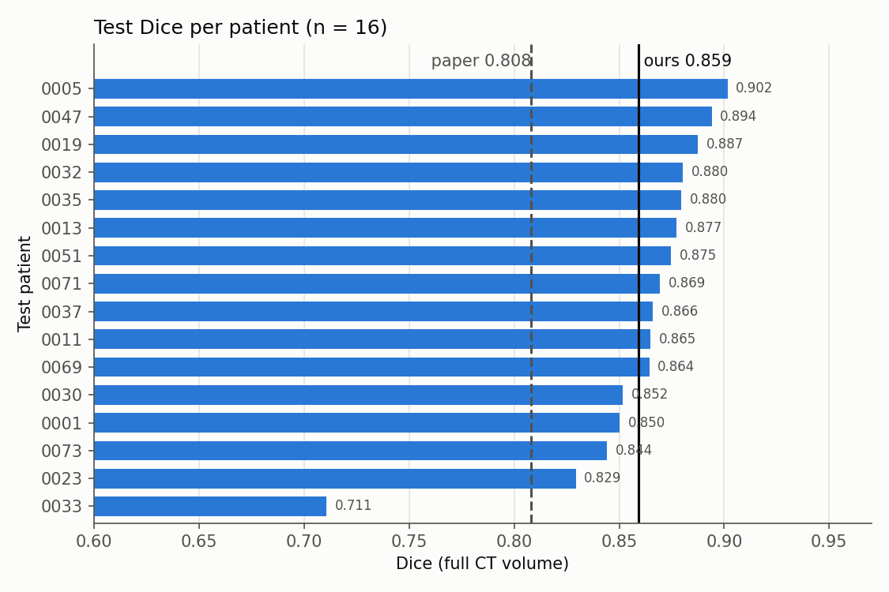
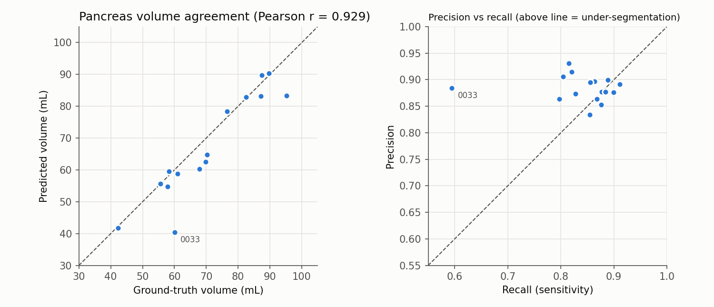
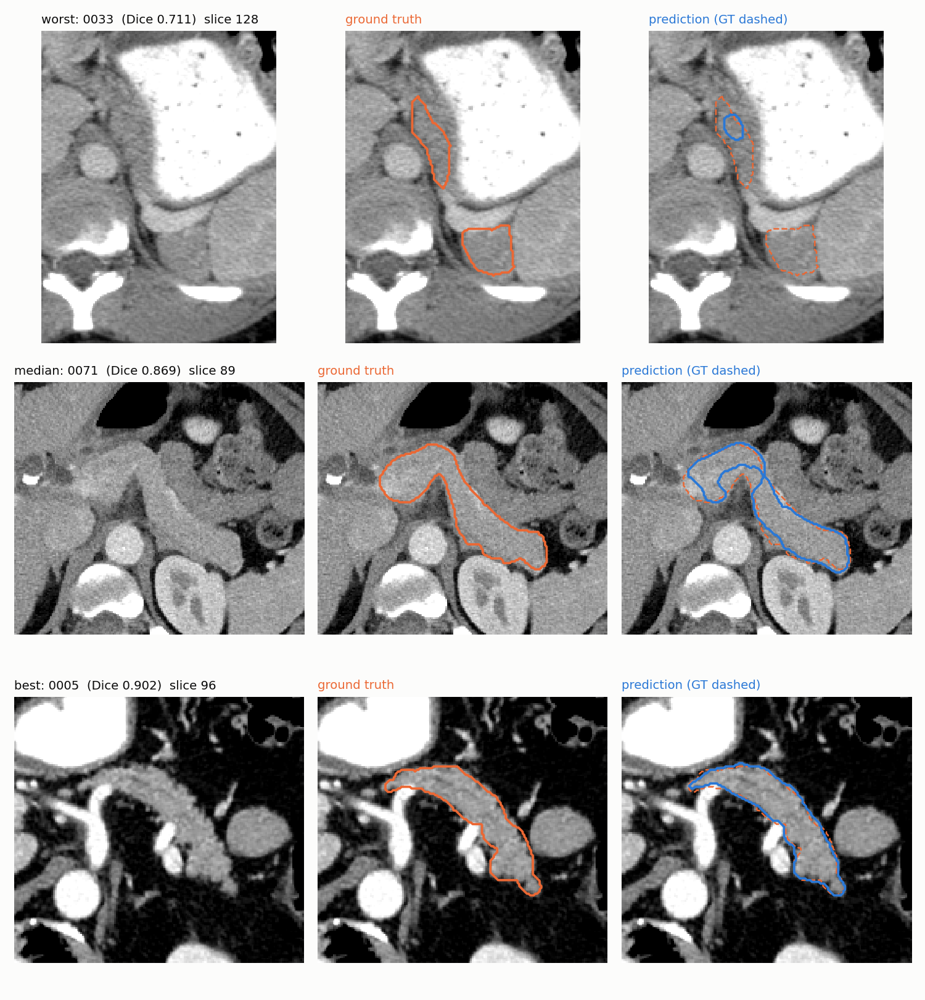
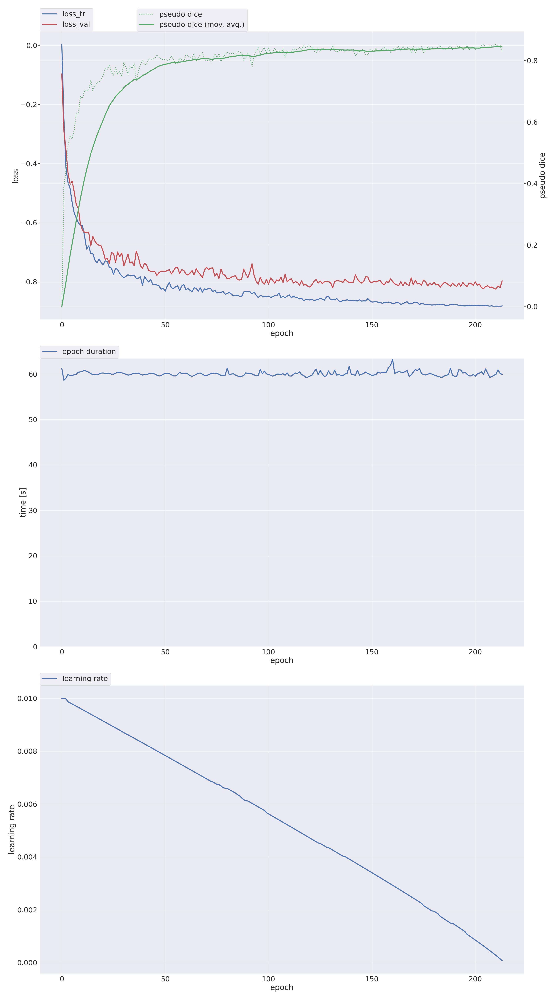

# Results: nnU-Net ResEnc-M (B1)

Generated by `tools/nnunet_figures.py` from the run's saved files in `results/nnunet/nnUNetTrainerBudget/`; nothing here is typed by hand.

## Headline

| Model | Test Dice (n = 16) | HD95 (mm) | ASSD (mm) |
|---|---|---|---|
| Base paper (3D Attention U-Net, NIH, Table 1) | 0.808 ± 0.021 | n/r | n/r |
| **nnU-Net ResEnc-M (ours)** | **0.859 ± 0.044** | **4.46 ± 2.42** | **1.10 ± 0.32** |

Mean test Dice is +0.051 vs the paper; 15/16 test patients reach Dice ≥ 0.80, 0 empty predictions.

## Setup

- **Model:** nnU-Net v2 3d_fullres, residual-encoder M preset (`nnUNetPlannerResEncM`): 6 stages, 32-320 features,
  patch 80 × 192 × 160, batch 2, spacing 1.0 × 0.879 × 0.879 mm. Dice + CE loss with deep supervision, SGD
  (Nesterov) with poly LR, nnU-Net's default augmentation, mirroring TTA and Gaussian sliding-window inference.
- **Data:** NIH Pancreas-CT, 80 patients, rebuilt from the TCIA DICOM + TCIA labels after the all-80 alignment
  check (`results/alignment_all80/`). Split = fold 0 of `splits/patient_splits.json`: 51 train / 13 validation /
  16 test (the same test patients as R0-R4 and Review-1).
- **Budget:** `nnUNetTrainerBudget` (`src/nnunet_trainer.py`) on one RTX 6000 Ada: 214 epochs in
  221.4/222 min of epoch time (62.3 s/epoch), LR schedule compressed to that end point;
  final EMA pseudo Dice 0.8458.
- **Post-processing:** chosen on the 13 validation cases only (nnU-Net `determine_postprocessing`: keep largest
  component), then applied to test.
- **Metrics:** `src/metrics.py` (`tools/nnunet_eval.py`) on the full CT volume at each case's native spacing.

## Test set (16 patients)

| Metric | Mean ± SD | Median | Min | Max |
|---|---|---|---|---|
| Dice | 0.859 ± 0.044 | 0.868 | 0.711 | 0.902 |
| Jaccard (IoU) | 0.755 ± 0.062 | 0.766 | 0.551 | 0.821 |
| Precision | 0.884 ± 0.024 | 0.881 | 0.834 | 0.931 |
| Recall | 0.840 ± 0.074 | 0.859 | 0.594 | 0.911 |
| HD95 (mm) | 4.46 ± 2.42 | 4.03 | 2.16 | 12.73 |
| ASSD (mm) | 1.10 ± 0.32 | 1.10 | 0.67 | 2.06 |
| V_pred / V_GT | 0.951 ± 0.090 | 0.976 | 0.672 | 1.026 |

### Per patient

| Patient | Dice | Jaccard | Precision | Recall | HD95 (mm) | ASSD (mm) | GT vol (mL) | Pred vol (mL) |
|---|---|---|---|---|---|---|---|---|
| PANCREAS_0001 | 0.850 | 0.740 | 0.874 | 0.828 | 4.30 | 1.09 | 57.8 | 54.8 |
| PANCREAS_0005 | 0.902 | 0.821 | 0.892 | 0.911 | 2.16 | 0.70 | 58.3 | 59.5 |
| PANCREAS_0011 | 0.865 | 0.762 | 0.915 | 0.820 | 5.08 | 1.14 | 69.8 | 62.6 |
| PANCREAS_0013 | 0.877 | 0.782 | 0.878 | 0.877 | 3.13 | 0.92 | 55.7 | 55.7 |
| PANCREAS_0019 | 0.887 | 0.798 | 0.876 | 0.899 | 3.39 | 0.90 | 76.4 | 78.4 |
| PANCREAS_0023 | 0.829 | 0.708 | 0.864 | 0.797 | 5.36 | 1.30 | 70.2 | 64.8 |
| PANCREAS_0030 | 0.852 | 0.742 | 0.905 | 0.804 | 3.14 | 1.12 | 67.9 | 60.3 |
| PANCREAS_0032 | 0.880 | 0.786 | 0.877 | 0.884 | 4.14 | 1.00 | 89.7 | 90.4 |
| PANCREAS_0033 | 0.711 | 0.551 | 0.884 | 0.594 | 12.73 | 2.06 | 60.0 | 40.4 |
| PANCREAS_0035 | 0.880 | 0.785 | 0.896 | 0.863 | 3.12 | 0.84 | 61.0 | 58.8 |
| PANCREAS_0037 | 0.866 | 0.763 | 0.864 | 0.868 | 5.16 | 1.18 | 82.4 | 82.8 |
| PANCREAS_0047 | 0.894 | 0.808 | 0.899 | 0.889 | 2.31 | 0.67 | 42.3 | 41.8 |
| PANCREAS_0051 | 0.875 | 0.777 | 0.895 | 0.855 | 3.92 | 1.04 | 87.1 | 83.2 |
| PANCREAS_0069 | 0.864 | 0.761 | 0.853 | 0.876 | 3.69 | 1.11 | 87.4 | 89.7 |
| PANCREAS_0071 | 0.869 | 0.769 | 0.931 | 0.815 | 5.19 | 1.21 | 95.2 | 83.3 |
| PANCREAS_0073 | 0.844 | 0.730 | 0.834 | 0.855 | 4.56 | 1.31 | 76.5 | 78.4 |

The weakest case, PANCREAS_0033 (Dice 0.711), is under-segmented: recall 0.594 vs
precision 0.884, predicted 40.4 mL vs ground truth 60.0 mL.

## Validation (13 patients, nnU-Net full-volume validation)

Mean Dice **0.8426**, IoU 0.7298 (before post-processing).

| Patient | Dice | IoU |
|---|---|---|
| PANCREAS_0004 | 0.743 | 0.591 |
| PANCREAS_0012 | 0.834 | 0.716 |
| PANCREAS_0016 | 0.850 | 0.739 |
| PANCREAS_0017 | 0.895 | 0.810 |
| PANCREAS_0029 | 0.833 | 0.714 |
| PANCREAS_0034 | 0.881 | 0.787 |
| PANCREAS_0038 | 0.866 | 0.764 |
| PANCREAS_0042 | 0.799 | 0.665 |
| PANCREAS_0052 | 0.860 | 0.755 |
| PANCREAS_0054 | 0.852 | 0.742 |
| PANCREAS_0055 | 0.879 | 0.784 |
| PANCREAS_0063 | 0.829 | 0.708 |
| PANCREAS_0066 | 0.831 | 0.711 |

## Figures

**Figure 1. Test Dice per patient.** Solid line = our mean, dashed = paper mean.



**Figure 2. Volume agreement and over/under-segmentation.** Left: predicted vs ground-truth pancreas volume
(dashed = identity). Right: precision vs recall per patient; points above/left of the dashed line miss more
pancreas than they add (under-segmentation), points below/right add more than they miss.



**Figure 3. Worst, median and best test cases.** Axial slice with the most missed pancreas (worst case) or the
largest ground-truth area (median, best), anterior up,
HU window [-100, 240], cropped around the pancreas for display. Orange = ground truth, blue = prediction.



**Figure 4. Training progress (nnU-Net).** Train/validation loss, pseudo Dice (validation patches) with its EMA,
learning rate and epoch time over the 214 epochs.



## Caveats

- Single fold, single seed, n = 16 test patients: the margin over the paper holds for this split; it is not a
  cross-validated estimate.
- The paper reports 5-fold CV + test on its own split; our split reuses the repo's seed-42 split.
- Pseudo Dice (Figure 4) is measured on random validation patches, not full volumes; the full-volume numbers are
  the tables above.

## Reproduce

```
sh scripts/nnunet_run.sh check && sh scripts/nnunet_run.sh prepare
NNUNET_BUDGET_MIN=222 sh scripts/nnunet_run.sh train && sh scripts/nnunet_run.sh test
python tools/nnunet_figures.py
```
